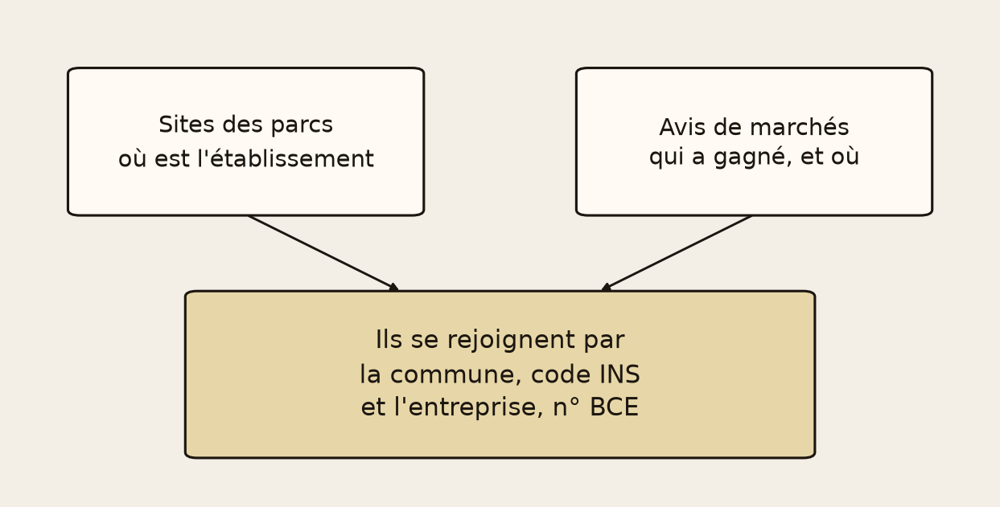
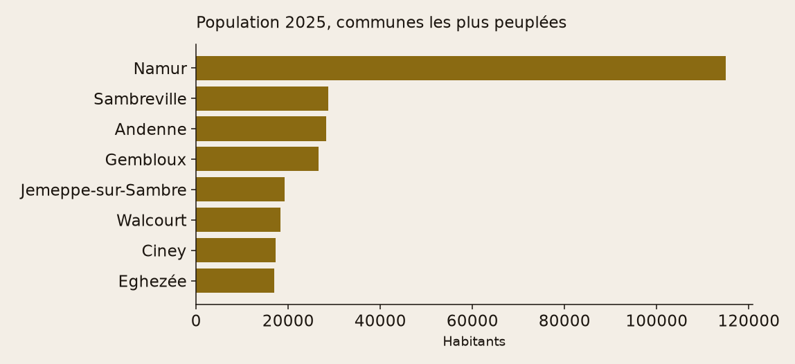
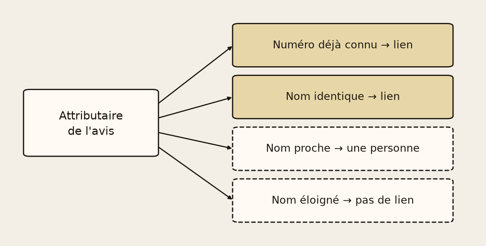
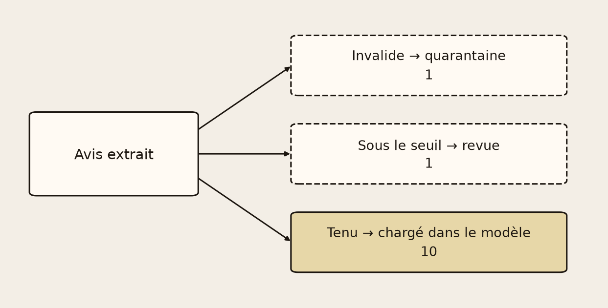

<!-- _class: cover -->

# Les marchés de la province arrivent-ils aux entreprises des parcs ?

Data engineering · Développement économique

Province de Namur · 2024-2026

Les sites et les avis sont un échantillon synthétique.

<!--
Question fil rouge. Montrer le schéma dès la slide suivante, pas un discours. La population est réelle. Les sites et les avis sont fabriqués. Pas de carte : les fichiers n'ont ni contour ni coordonnées. Environ vingt secondes.
-->

---

<!-- _class: chart -->

# Deux listes ne se rejoignent que par la commune et l'entreprise.

<!--
Lire le schéma du haut vers le bas. À gauche les sites des parcs, à droite les avis. La case dorée est la seule jointure : le code INS de la commune, et le numéro BCE de l'entreprise. Sans ces deux clés, les listes restent côte à côte.
-->

---

<!-- _class: chart -->

# Une ligne n'est publiée qu'après le contrôle.

<!--
Lire de gauche à droite. Fichier, contrôle, base brute, modèle. La case en pointillés est la ligne écartée : le reste du fichier continue. Recharger ne compte pas deux fois. Si on demande l'outil du contrôle : pydantic. Ne le nommer que dans ce cas.
-->

---

<!-- _class: chart -->

# Le site joint les deux. L'avis rejoint l'entreprise seulement si le lien tient.

<!--
Le site, en doré, pointe toujours vers la commune et vers l'entreprise. L'avis pointe vers la commune. Le trait pointillé vers l'entreprise ne part que si la preuve suffit. Les deux cases du bas sont l'échantillon. La commune, elle, est la population réelle.
-->

---

<!-- _class: chart -->

# Namur domine. Le référentiel compte 38 communes.

<!--
Seule série réelle. On n'affiche que les plus peuplées, pour que les noms se lisent. Le référentiel en a 38. Namur est très au-dessus des suivantes. Ce n'est pas un jugement sur les parcs : ce sont des habitants Statbel 2025.
-->

---

<!-- _class: chart -->

# Les sites fabriqués se regroupent en quelques activités.

<!--
Ne pas lire ce graphe comme un portrait de la province. 300 sites, fabriqués, posés sur les vraies communes. L'activité vient d'une règle sur le code, pas d'une visite. Sept cas du fichier d'évaluation restent douteux.
-->

---

<!-- _class: chart -->

# Un lien n'est publié que si la preuve suffit.

<!--
Partir de la case de gauche. Deux issues dorées sont des liens : le numéro déjà connu, ou le nom identique. Les deux cases en pointillés ne comptent pas : un nom proche attend une personne, un nom éloigné ne lie pas. Les seuils chiffrés ne sont pas sur la figure : ce ne sont pas des mesures.
-->

---

<!-- _class: full -->

# Aucun site lié n'est dans la commune de l'avis.

10 avis ont été chargés. 8 retrouvent une entreprise du fichier.

C'est le chiffre qu'on peut citer sur cet échantillon.

<!--
Le résultat, après les schémas. Parmi les 8 entreprises retrouvées, aucune n'a aussi un site dans la commune de l'avis. Les sites ont été placés sur de vraies communes, sans suivre les avis. Le jour où les fichiers officiels remplacent l'échantillon, le même calcul répond à la question.
-->

---

<!-- _class: chart -->

# Le lien à l'entreprise se voit en trois issues.

<!--
Lire les trois barres : lié, à relire, sans lien. Huit, un, un. La barre du milieu n'entre pas dans les huit. C'est le geste du lundi : valider ou écarter ce nom avant de le citer.
-->

---

<!-- _class: chart -->

# Un avis douteux n'entre pas dans le modèle.

<!--
Trois portes. Invalide : quarantaine, ici un montant faux. Sous le seuil : une personne, et l'avis n'est pas chargé. La case dorée est la seule qui entre dans le modèle : 10 avis. Le fichier, lui, n'est pas jeté.
-->

---

<!-- _class: chart -->

# 79 champs sur 80 concordent. Les libellés ne sont pas relus.

<!--
79 contre 1. Ce n'est pas une exactitude validée : personne n'a relu les libellés. Le champ écarté est voulu, le cache se trompe. Le dire avant qu'on prenne 79 pour une précision de production.
-->

---

<!-- _class: dark -->

# Les limites tiennent en trois phrases.

Les sites et les avis restent un échantillon synthétique.

Les activités proposées n'ont pas été relues.

Le site lié n'est pas dans la commune de l'avis.

<!--
Pas de carte à montrer : aucun fichier n'a de contour ni de coordonnées. Le registre officiel des entreprises demande un compte, les avis officiels n'ont pas été lus. On n'a pas inventé ces fichiers. Le zéro géographique est vrai sur cet échantillon, pas sur les marchés réels.
-->

---

<!-- _class: actions -->

# Lundi, l'intercommunale pourrait s'en servir.

- Dire à une commune quels sites de l'échantillon elle porte
- Écarter un avis au montant faux sans jeter le fichier
- Relire le nom encore douteux avant de le compter
- Rejouer le chargement sans compter deux fois le même site

<!--
Conditionnel. Les quatre gestes marchent sur l'échantillon. L'orchestration, l'alerte et l'historique des changements ne sont pas dans la démo. Un journal de passage et un contrôle de fraîcheur en tiennent lieu.
-->

---

<!-- _class: cta -->

# La suite se lit dans la documentation.

[Documentation](../dbt/index.html)

[Dépôt](https://github.com/dimiphoton/BEP-project)

<!--
Fermer sur la documentation du modèle. Proposer de revenir au schéma des deux clés ou aux trois issues. Le conducteur est la vue présentateur, touche p sur le HTML, ou Marp: Open Presenter View dans Cursor.
-->
