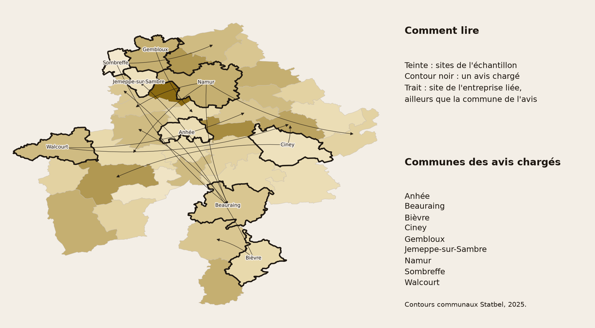
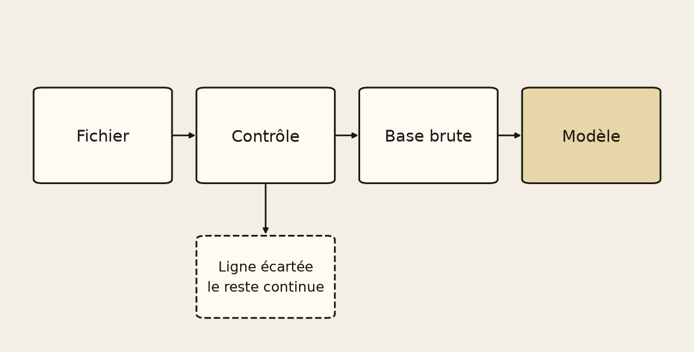
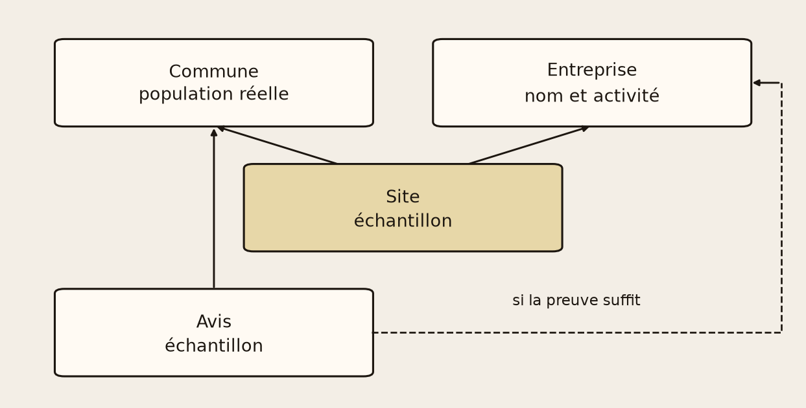
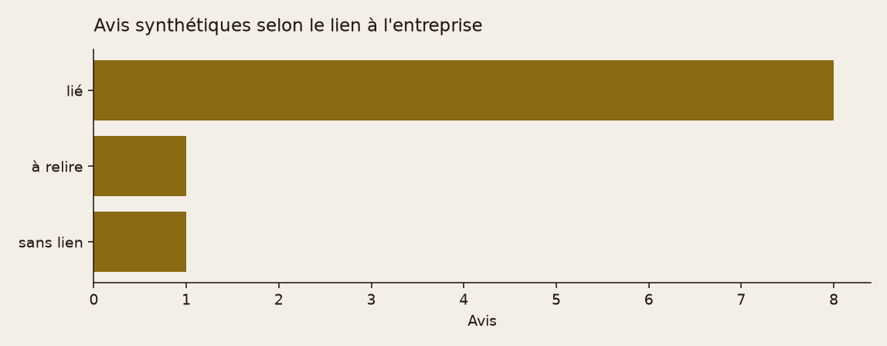

<!-- _class: cover -->

# Les marchés du BEP et des communes retombent-ils sur une entreprise de leurs parcs ?

Data engineering · Développement économique

Province de Namur · 2024-2026

Les sites et les avis sont un échantillon synthétique.

<!--
Intercommunale de développement économique. Elle aménage des parcs. Les communes adhérentes et le BEP passent aussi des marchés. La question est de savoir si l'entreprise qui a gagné a un site dans la commune où le travail se fait. La population est réelle. Les sites et les avis sont fabriqués, étiquetés comme tels.
-->

---

<!-- _class: actions -->

# Le BEP et les communes adhérentes tiennent deux listes séparées.

- Les parcs : une entreprise occupe un site, dans une commune
- Les marchés : un avis dit qui a gagné, et où le travail se fait
- Rien ne relie encore le gagnant à un site du parc

<!--
Acteurs : l'intercommunale, les communes adhérentes, les entreprises des parcs. Sans jointure, un tableau d'avis et un tableau de sites ne répondent pas. C'est le trou que le modèle ferme.
-->

---

<!-- _class: chart -->

# L'entreprise liée a son site dans une autre commune.

<!--
Contours réels des 38 communes, Statbel 2025, province 90000. Teinte : nombre de sites de l'échantillon. Contour épais : un avis a été chargé. Trait : vers la commune où l'entreprise liée a un site. Aucun trait ne reste sur place. Les parcs dessinés ne sont pas les parcs réels.
-->

---

<!-- _class: full -->

# 10 avis chargés, 8 liés, 0 site dans la commune de l'avis.

C'est le compte que la carte dessine.

<!--
Lire dans l'ordre. 10 avis tiennent dans le modèle. 8 retrouvent une entreprise du fichier. Aucune de ces entreprises n'a de site dans la commune de l'avis. Les sites ont été posés sur les vraies communes, sans suivre les avis.
-->

---

<!-- _class: actions -->

# Trois fichiers entrent. Un seul est une statistique publique.

- Statbel, réel : 38 communes, code INS et population
- Établissements, échantillon synthétique : 300 sites, 250 entreprises
- Avis, échantillon synthétique : 10 chargés, 1 écarté

<!--
Colonnes réelles. Statbel : nis_code, municipality_name, population, reference_year 2025. Établissements : enterprise_number, nis_code, nace_code. Avis : un texte libre. Le registre BCE et les portails d'avis n'ont pas été lus.
-->

---

<!-- _class: actions -->

# La tâche est un compte par commune d'exécution.

- Avis chargés dans cette commune
- Avis dont l'entreprise est dans le fichier
- Parmi eux, ceux qui ont un site dans cette commune

<!--
Trois colonnes : contract_count, linked_count, same_municipality_count. La carte répond à la troisième. On ne mesure pas un effet économique. On rend le compte reproductible.
-->

---

<!-- _class: actions -->

# Quatre outils. Chacun écrit à un seul endroit.

- Python contrôle chaque ligne et charge le brut
- PostgreSQL sépare le brut, le modèle et l'exploitation
- dbt construit le modèle et passe 88 tests
- Docker démarre la base

<!--
Rôles : ingest écrit le brut, dbt écrit le modèle, reader ne lit que le modèle. 88 tests réussis, 0 échec.
-->

---

<!-- _class: chart -->

# Une ligne invalide sort. Le reste du fichier continue.

<!--
Ordre réel : communes, établissements, avis, puis le lien entreprise. La case en pointillés est ops.rejects. Recharger remplace la clé, ça ne double pas.
-->

---

<!-- _class: chart -->

# Le site a toujours une commune. L'avis, une entreprise seulement si le lien tient.

<!--
Le site joint la commune et l'entreprise. L'avis joint la commune par le code INS extrait. Le trait pointillé est la résolution du nom ou du numéro. Sans ce lien, l'avis reste, mais le compte de sites dans la commune ne bouge pas.
-->

---

<!-- _class: chart -->

# Les 10 avis se répartissent en trois issues.

<!--
Lié : numéro déjà dans le fichier, ou nom identique. À relire : nom proche, non compté dans les 8. Sans lien : nom éloigné. La barre du milieu est une file, pas un résultat publié.
-->

---

<!-- _class: chart -->

# 1 avis est écarté. 1 autre attend. 10 seuls sont chargés.

<!--
L'écarté a un montant négatif. Celui qui attend a une confiance trop basse : il n'entre pas dans le fait. Les 10 de la case dorée sont ceux de la carte.
-->

---

<!-- _class: actions -->

# Avec cette table, trois questions ont une réponse.

- Quels avis sont chargés dans une commune
- Lesquels retrouvent une entreprise du fichier
- Lesquels ont aussi un site dans cette commune

<!--
Sur cet échantillon, la troisième réponse est 0, et la carte le montre. Le même calcul s'appliquerait aux fichiers officiels le jour où ils remplacent l'échantillon. Ce n'est pas en service.
-->

---

<!-- _class: dark -->

# Les limites tiennent en trois phrases.

Les sites et les avis restent un échantillon synthétique.

Les contours sont réels. Les parcs dessinés ne le sont pas.

Le compte de sites dans la commune de l'avis est 0.

<!--
BCE et portails d'avis non lus. L'accord de famille 0,98 porte sur 50 libellés non relus. Ne pas le présenter comme une exactitude validée. Les contours viennent de Statbel, situation 2025, pas d'un dessin.
-->

---

<!-- _class: cta -->

# On relit le modèle dans la documentation.

[Documentation](../dbt/index.html)

[Dépôt](https://github.com/dimiphoton/BEP-project)

<!--
Ouvrir la table des avis par commune. Le texte oral est la vue présentateur, touche p. Les decks anglais n'ont pas été réécrits.
-->
