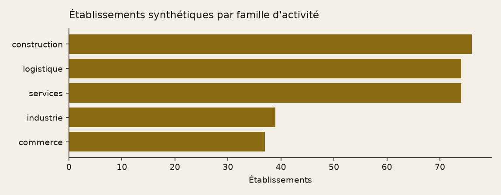

<!-- _class: cover -->

# Sait-on dans quelle commune se trouve chaque site ?

Data engineering · Développement économique

Province de Namur · 2024-2026

Les sites sont un échantillon synthétique.

---

<!-- _class: full -->

# Sans commune, un parc n'est qu'une liste de noms.

L'intercommunale doit pouvoir dire où sont les sites.

Une commune adhérente doit s'y reconnaître.

Deux fichiers posés côte à côte ne répondent pas.

---

<!-- _class: full -->

# Trois interlocuteurs partagent la même liste.

L'intercommunale prépare les parcs.

Les communes adhérentes accueillent les sites.

Les entreprises sont celles qu'il faudra reconnaître ensuite.

---

<!-- _class: full -->

# Un site n'est publié qu'une fois rattaché.

On lit d'abord les communes, avec leur population.

On lit ensuite les sites.

Une ligne qui ne tient pas est écartée. Le reste continue.

---

<!-- _class: full -->

# Le territoire est réel. Les sites ne le sont pas.

Les 38 communes viennent du fichier public de population.

Les 300 sites ont été fabriqués pour la démonstration.

On ne les lit pas comme une observation du terrain.

---

<!-- _class: dark -->

# On situe les sites, et aussi les avis.

Chaque site publié a une commune.

10 avis synthétiques aussi.

Le lien entre l'avis et l'entreprise n'est pas fait.

---

<!-- _class: full -->

# 300 sites, et aucun sans commune.

Ils reposent sur les 38 communes de la province.

Une adresse fausse ne passe pas.

Le fichier, lui, n'est pas jeté pour autant.

---

<!-- _class: chart -->

# Les sites fabriqués se regroupent en quelques activités.

---

<!-- _class: full -->

# Ce n'est pas encore une réponse sur les marchés.

Les noms d'entreprises sont fabriqués.

L'activité vient d'une règle, pas d'une visite sur place.

Les avis sont fabriqués, et liés seulement par la commune.

---

<!-- _class: full -->

# Le registre officiel des entreprises demande un compte.

On n'a pas inventé de fichier à sa place.

Les sites sont donc un échantillon synthétique.

Les communes, elles, viennent d'une source publique.

---

<!-- _class: dark -->

# Les limites tiennent en trois phrases.

Les sites restent un échantillon synthétique.

Les activités proposées n'ont pas été relues.

Les avis ne sont pas encore liés à une entreprise.

---

<!-- _class: actions -->

# Lundi, l'intercommunale pourrait s'en servir.

- Dire à une commune quels sites de l'échantillon elle porte
- Relire les 7 cas encore douteux
- Rejouer le chargement sans compter deux fois le même site
- Relier ensuite l'avis à l'entreprise, ce n'est pas fait

---

<!-- _class: cta -->

# La suite se lit dans la documentation.

[Documentation](../dbt/index.html)

[Dépôt](https://github.com/dimiphoton/BEP-project)
