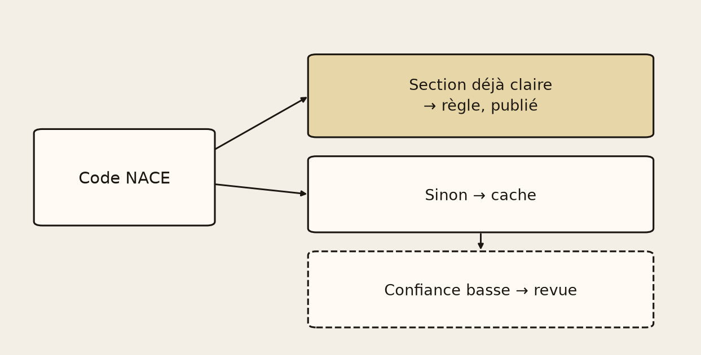
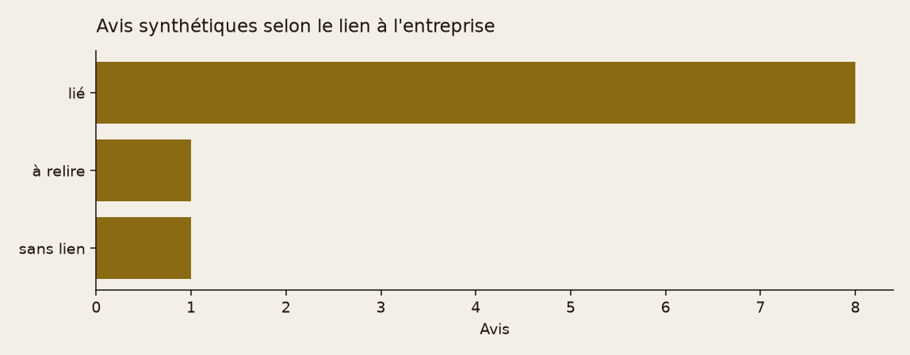
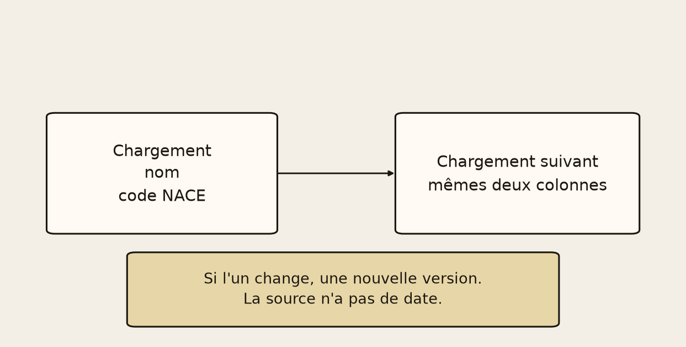

<!-- _class: cover -->

# Un avis lié a-t-il un site dans la commune d'exécution ?

Data engineering · Développement économique · Python / PostgreSQL / dbt

Province de Namur · 2024-2026

Les établissements et les avis sont un échantillon synthétique.

<!--
Question de recherche. Maille : nis_code et enterprise_number. Pas de carte : les sources n'ont ni géométrie ni coordonnées. Les schémas qui suivent sont le support. Population Statbel réelle. Sites et avis synthétiques.
-->

---

<!-- _class: chart -->

# Deux sources ne se rejoignent que par deux clés.

<!--
Projet A : établissements. Projet B : avis. Clé minimale : le code INS. Clé forte : le numéro BCE, sinon le nom. On ne mesure pas un effet économique. On construit le joint qui permet de le compter.
-->

---

<!-- _class: chart -->

# Le contrôle écrit le brut. dbt seul écrit le modèle.

<!--
Lire la ligne du haut, puis les deux portes du bas. Les deux partent du contrôle, avant raw. ops.rejects garde la ligne invalide. ops.review_queue garde ce qui est sous le seuil : ce n'est pas publié. staging est une vue, marts une table. Upsert sur la clé naturelle. Trois rôles : ingest écrit raw et ops, dbt écrit staging et marts, reader ne lit que marts.
-->

---

<!-- _class: chart -->

# Le site pointe vers les deux dimensions. L'avis, vers la commune.

<!--
fact_establishment joint dim_municipality et dim_enterprise. fact_public_contract joint seulement la commune : le numéro d'entreprise n'est pas une clé du fait, il est résolu à part. Le mart croise les deux. Grain : le site n'est pas l'entreprise. 300 établissements, 250 entreprises.
-->

---

<!-- _class: chart -->

# Namur domine. Le référentiel compte 38 communes.

<!--
Seule série réelle, extrait Statbel 2025, province 90000, somme âge, sexe, nationalité, état civil. Huit barres seulement : les 38 noms ne tenaient pas sur une slide. Namur est très au-dessus. Chaque site et chaque avis doit tomber sur une commune de ce référentiel.
-->

---

<!-- _class: chart -->

# La famille est déduite du code, pas observée sur le terrain.

<!--
300 sites synthétiques. Ce graphe décrit l'échantillon, pas le tissu namurois. Sur les codes réellement chargés, la règle suffit : aucun appel au cache pendant l'ingestion. L'évaluation, elle, force des codes ambigus.
-->

---

<!-- _class: chart -->

# La règle classe. Le cache ne parle que dans le silence.

<!--
Liste fermée : industrie, logistique, commerce, services, construction, autre. Section univoque : règle, confiance pleine. Sinon le cache. Confiance basse : revue, pas une famille publiée comme sûre. Le mode live s'arrête : aucun fournisseur, aucun format d'API inventé. Accord mesuré 0,98, soit 49 sur 50. Ces 50 libellés ne sont pas relus. 7 réponses sous le seuil.
-->

---

<!-- _class: chart -->

# Le numéro tranche. Le nom douteux attend.

<!--
rapidfuzz token_sort_ratio après normalisation, seulement si le numéro n'est pas dans le référentiel. 95 lie, 80 ouvre la revue, en dessous pas de lien. Ces seuils ne sont pas des mesures du fichier : ils ne sont pas écrits sur la figure. Relancer remplace les liens, ça ne les double pas.
-->

---

<!-- _class: full -->

# Huit liens, et aucun site dans la commune de l'avis.

10 avis ont une commune. 8 sont liés.

88 tests dbt réussissent. 0 test échoue.

Le compte géographique est vide. C'est le chiffre qu'on peut citer.

<!--
mart_contracts_by_municipality : avis chargés, statut lié, puis un établissement de la même entreprise et du même nis_code. La somme est zéro. Les sites ont été posés sur les vraies communes, indépendamment des avis. Les 88 tests couvrent l'unicité, la relation vers la commune, le code de la province, le montant positif.
-->

---

<!-- _class: chart -->

# Le lien à l'entreprise se lit en trois issues.

<!--
Huit liés, par numéro connu ou par nom identique. Un nom proche reste à relire et n'est pas dans les huit. Un nom éloigné ne lie pas.
-->

---

<!-- _class: chart -->

# Sous le seuil, l'avis n'entre pas dans le fait.

<!--
1 ligne en quarantaine : montant négatif. 1 avis sous le seuil : le cache se trompe de montant, il n'est pas chargé. 10 avis tiennent et entrent dans fact_public_contract. Le schéma pydantic refuse un code INS hors province et un numéro BCE invalide.
-->

---

<!-- _class: chart -->

# 79 champs sur 80 concordent. Les libellés ne sont pas relus.

<!--
Huit champs par avis, dix avis du fichier d'évaluation. Le champ écarté est voulu. label_verified reste faux. Ne pas dire précision du modèle. L'exactitude mesurée est 0,9875.
-->

---

<!-- _class: chart -->

# Le nom et le code laissent une trace, sans date inventée.

<!--
enterprise_snapshot, stratégie check, sur le nom et le code NACE. Pas de timestamp dans la source, donc pas de date fabriquée. Si l'un change au chargement suivant, une nouvelle version est gardée. C'est le substitut, sur cette dimension, d'un flux de changements.
-->

---

<!-- _class: full -->

# Ce qui a cassé a été corrigé, pas contourné.

Le schéma dbt ne préfixe plus les noms du socle.

Un Postgres local occupait déjà le port : le conteneur écoute à côté.

Le journal de passage retient le succès, pas seulement le fichier.

<!--
Trois faits du journal. dbt créait un schéma préfixé, alors que les rôles visent staging et marts. Le port local était pris : on change le port dans l'environnement. Le contrôle de fraîcheur regarde le dernier succès du pipeline. Il échoue si ce succès a plus de sept jours, ou si le volume gardé chute de plus de la moitié.
-->

---

<!-- _class: dark -->

# Les limites tiennent en trois lignes.

Les établissements et les avis restent un échantillon synthétique.

Les 50 libellés de famille ne sont pas relus.

Le lien ne place pas le site dans la commune de l'avis.

<!--
Pas de carte : pas de géométrie dans les sources. La CI est écrite, elle n'a pas été observée sur GitHub. Orchestration, alerte, mode live, registre BCE, portails d'avis : hors démo. La quarantaine et la file de revue montrent le dernier passage. Le journal des appels, lui, s'ajoute.
-->

---

<!-- _class: actions -->

# Lundi, l'intercommunale pourrait s'en servir.

- Voir quelles communes concentrent les établissements
- Écarter un avis invalide sans recharger à la main
- Relire le nom et les familles encore en revue
- Rejouer un chargement sans doubler les sites

<!--
Conditionnel. make up, ingest, build, test, puis eval-nace, eval-contracts, healthcheck. Le healthcheck n'est pas une alerte de production.
-->

---

<!-- _class: cta -->

# On rejoue le socle, puis on lit la doc.

[Documentation dbt](../dbt/index.html)

[Dépôt](https://github.com/dimiphoton/BEP-project)

`make up`

`make ingest`

`make build`

`make test`

Python · PostgreSQL · dbt · Docker

<!--
Dans la doc dbt, ouvrir fact_public_contract et mart_contracts_by_municipality. Le conducteur de chaque slide est le commentaire HTML : vue présentateur, touche p. Les decks anglais n'ont pas été réécrits.
-->
