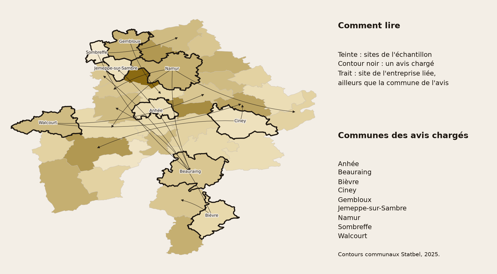
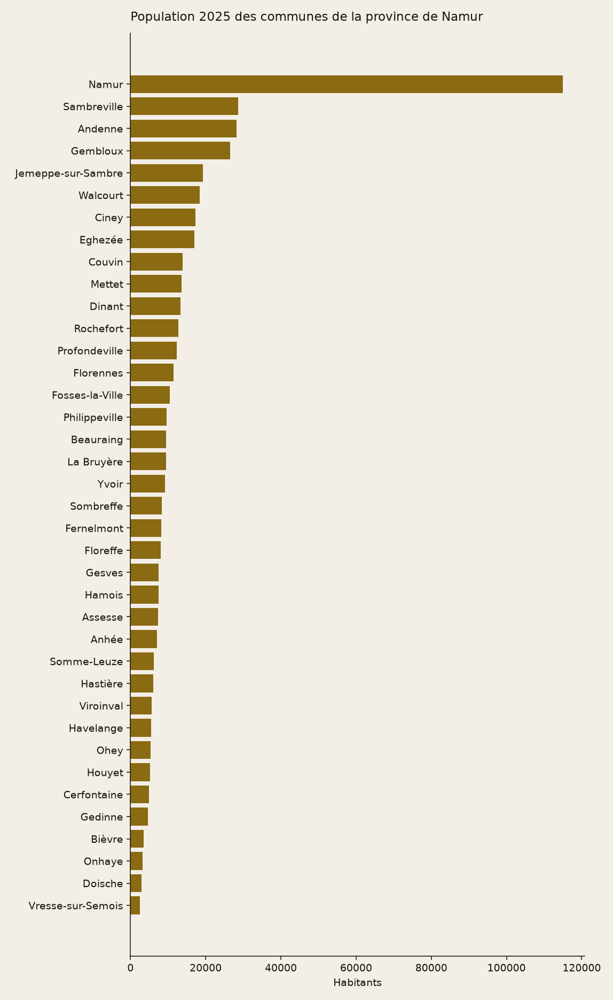
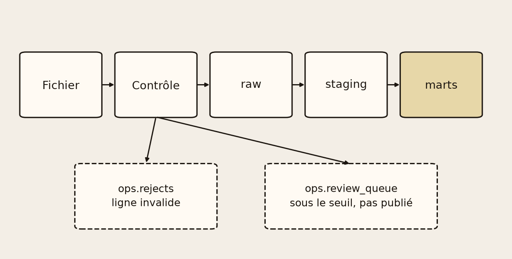
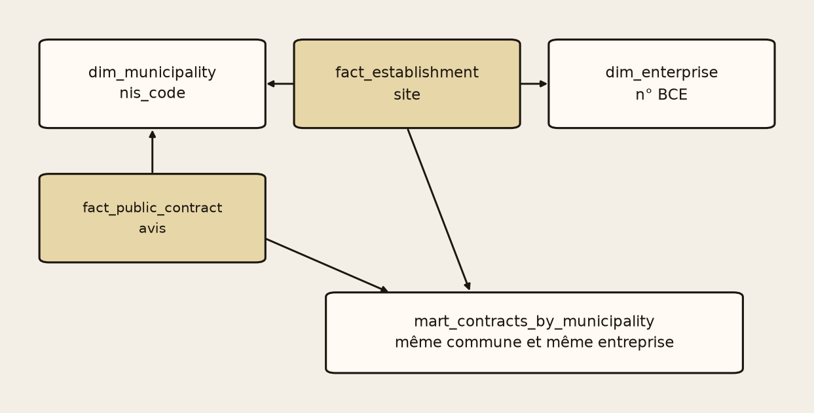
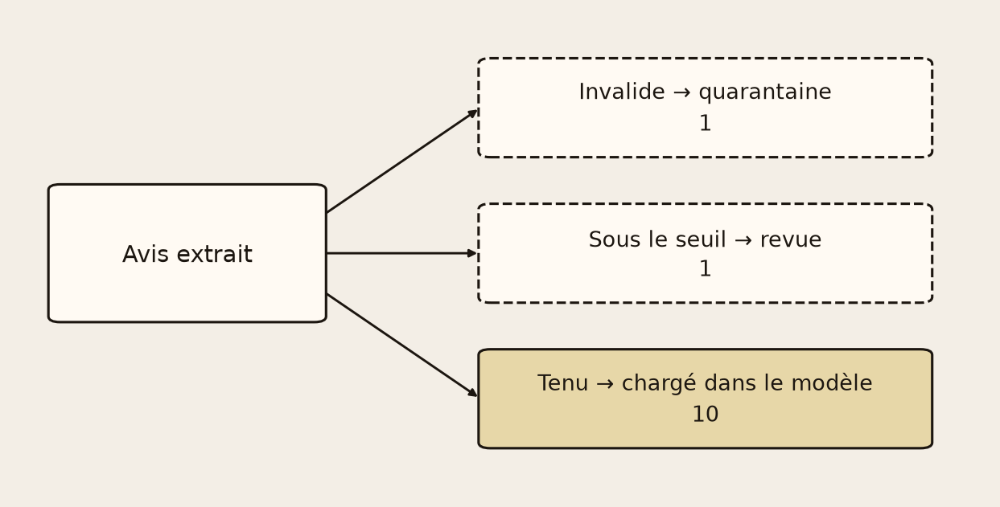
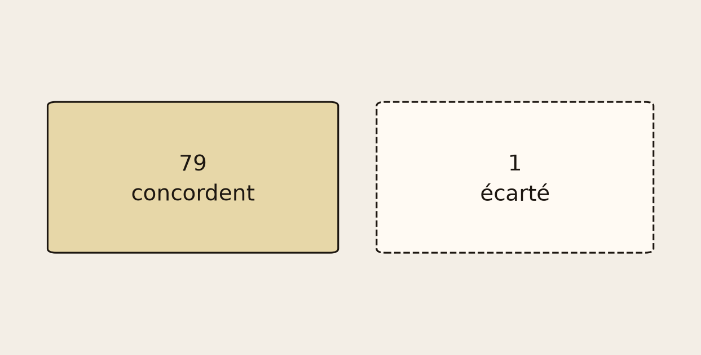

<!-- _class: cover -->

# Les marchés du BEP et des communes retombent-ils sur une entreprise de leurs parcs ?

Data engineering · Développement économique · Python / PostgreSQL / dbt

Province de Namur · 2024-2026

Les établissements et les avis sont un échantillon synthétique.

<!--
La mesure est same_municipality_count : avis liés dont l'entreprise a aussi un établissement au même nis_code. Population Statbel réelle. Sites et avis synthétiques. La carte montre le décalage avant le SQL.
-->

---

<!-- _class: actions -->

# Deux grains ne se rencontrent pas tant qu'on ne les joint pas.

- Site : enterprise_number et nis_code, dans un parc de l'échantillon
- Avis : gagnant et nis_code d'exécution, texte libre au départ
- La question : le gagnant lié a-t-il un site sur ce nis_code

<!--
Acteurs : intercommunale BEP, communes adhérentes, entreprises des parcs. Le BEP aménage les parcs et passe des marchés, comme les communes. Le registre BCE et les portails d'avis n'ont pas été lus.
-->

---

<!-- _class: chart -->

# L'entreprise liée a son site dans une autre commune.



<!--
Contours Statbel 2025, province 90000, les 38 nis_code du référentiel. Teinte : sites du CSV synthétique. Contour : avis passé par prepare_contracts, donc chargé. Trait : resolve_winner en linked, puis un site de cette entreprise hors du nis_code de l'avis. Même règles que l'ingestion, sans la base.
-->

---

<!-- _class: full -->

# same_municipality_count vaut 0.

10 avis dans le fait. 8 ont status linked.

C'est le trait de la carte, compté.

<!--
Les 8 liens sont dans linked_count. Aucun ne satisfait le exists sur le même nis_code. Les sites synthétiques ont été posés sur les communes réelles, indépendamment des avis.
-->

---

<!-- _class: chart -->

# La population 2025 est le seul chiffre public du référentiel.



<!--
Extrait versionné, province 90000, somme des cellules âge, sexe, nationalité, état civil. Huit barres pour lire les noms. Le référentiel en a 38. Chaque site et chaque avis doit porter un de ces nis_code. Ce graphe n'est pas les parcs.
-->

---

<!-- _class: actions -->

# Trois fichiers entrent. Un seul est une statistique publique.

- Statbel, réel : 38 communes, nis_code et population
- Établissements, échantillon synthétique : 300 sites, 250 entreprises
- Avis, échantillon synthétique : 10 chargés, 1 écarté

<!--
Statbel : nis_code, municipality_name, province_nis_code, population, reference_year. Établissements : establishment_number, enterprise_number, nis_code, nace_code. Avis : notice_id et notice_text. L'extraction vise objet, adjudicateur, lots, CPV, montant, nis_code, attributaire, numéro BCE.
-->

---

<!-- _class: actions -->

# Quatre outils. Chacun écrit à un seul endroit.

- Python : pydantic, quarantaine, upsert
- PostgreSQL : raw, staging, marts, ops
- dbt : vues, tables, 88 tests, 0 échec
- Docker : la base et les trois rôles

<!--
ingest_rw écrit raw et ops. dbt_rw lit raw et écrit staging et marts. reader_ro ne lit que marts. Mots de passe hors du dépôt. Les 88 tests incluent l'unicité, la relation vers la commune, le code de province et le montant positif.
-->

---

<!-- _class: chart -->

# Le contrôle précède raw. dbt seul écrit marts.



<!--
Les deux portes partent du contrôle. ops.rejects : ligne invalide, le fichier continue. ops.review_queue : sous le seuil, non publié. staging est une vue. marts est une table. Relancer remplace la clé naturelle.
-->

---

<!-- _class: actions -->

# resolve_winner lie par le numéro, puis par le nom.

```python
if number and number in by_number:
    status = "linked"
elif best_score >= AUTO_SCORE:
    status = "linked"
elif best_score >= REVIEW_SCORE:
    status = "review"
else:
    status = "unmatched"
```

Décision de `resolve_winner`, `src/observatory/entities.py`

<!--
Fonction réelle, constantes AUTO_SCORE et REVIEW_SCORE. Le numéro connu gagne avant rapidfuzz token_sort_ratio. Les seuils ne sont pas des mesures : ils ne sont pas affichés. 95 lie, 80 ouvre la revue. Relancer remplace raw.contract_enterprise_link.
-->

---

<!-- _class: actions -->

# Le mart teste un site au même numéro et au même code.

```sql
where site.enterprise_number
    = contract_link.enterprise_number
  and site.nis_code = contract_link.nis_code
```

`dbt/models/marts/mart_contracts_by_municipality.sql`

<!--
Extrait du exists sur fact_establishment. Le left join en amont ne garde que status = linked. La somme de ce test est same_municipality_count. Si le numéro n'est pas lié, la condition ne peut pas réussir.
-->

---

<!-- _class: chart -->

# Le site pointe vers deux dimensions. L'avis, vers la commune.



<!--
fact_establishment a nis_code et enterprise_number. fact_public_contract a nis_code, pas une clé entreprise : le lien est une table à part. Le mart croise les deux. Colonnes livrées : nis_code, municipality_name, contract_count, linked_count, same_municipality_count, amount_eur.
-->

---

<!-- _class: chart -->

# Les 10 avis du fait se séparent en 8, 1 et 1.


<!--
Compte de raw.contract_enterprise_link. Lié : method number ou name au-dessus du seuil haut. À relire : method name dans la zone grise. Sans lien : method none. Seul le statut linked entre dans le mart.
-->

---

<!-- _class: chart -->

# 1 ligne va en quarantaine. 1 avis reste sous le seuil.



<!--
rejects.synthetic_public_contracts = 1, un montant négatif refusé par le schéma. extraction_below_threshold = 1, non chargé. counts.public_contracts = 10. Le schéma exige un montant positif, un CPV à 8 chiffres, un nis_code de la province, un numéro BCE valide s'il est présent.
-->

---

<!-- _class: chart -->

# 79 champs sur 80 concordent. Les 10 libellés ne sont pas relus.



<!--
extraction_fields_matched 79, extraction_fields_scored 80, extraction_field_accuracy 0,9875. Huit champs par avis. Le champ écarté est voulu. label_verified reste faux. Ce n'est pas une exactitude de production.
-->

---

<!-- _class: actions -->

# La table répond à trois questions sur cet échantillon.

- contract_count par nis_code d'exécution
- linked_count parmi ces avis
- same_municipality_count, mesuré à 0

<!--
Utilité actuelle : relire la file, écarter l'avis invalide, voir sur la carte où part le site de l'entreprise liée. Le même SQL s'appliquerait aux fichiers officiels. Ils ne sont pas dans cette démo.
-->

---

<!-- _class: dark -->

# Les limites tiennent en trois lignes.

Les établissements et les avis restent un échantillon synthétique.

Les contours sont réels. Les parcs dessinés ne le sont pas.

same_municipality_count ne place aucun site dans la commune de l'avis.

<!--
Accord NACE 0,98 sur 50, dont 7 sous le seuil. Les 50 libellés de famille ne sont pas relus. La CI n'a pas été observée sur GitHub. ops.rejects et ops.review_queue sont l'état du dernier passage. ops.ai_log s'ajoute.
-->

---

<!-- _class: cta -->

# On rejoue le chargement, puis on lit le mart.

[Documentation dbt](../dbt/index.html)

[Dépôt](https://github.com/dimiphoton/BEP-project)

`make up`

`make ingest`

`make build`

`make test`

Python · PostgreSQL · dbt · Docker

<!--
Puis eval-contracts et healthcheck si le temps reste. Dans la doc, ouvrir mart_contracts_by_municipality. Vue présentateur : touche p. Decks anglais non réécrits.
-->
